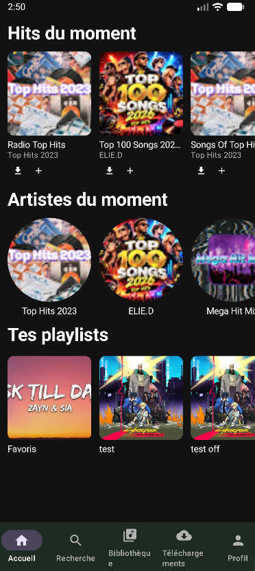

# 🎵 SoundFlow Mobile

Une application Android pour écouter de la musique, gratuite et sans compte !

## 📱 Captures d'écran

  
  

## ✨ Ce que tu peux faire

- 🔍 **Chercher et écouter** n'importe quel titre et importer n'importe quel son !
- 📃 **Créer des playlists**, les partager
- ⬇️ **Télécharger** tes musiques pour les écouter sans internet
- 🎤 **Suivre les paroles** en direct pendant la lecture (ne marche pas pour tout)

## 📲 Installer l'appli

1. Va dans l'onglet [**Releases**](../../releases)
2. Télécharge le fichier `.apk`
3. Ouvre-le sur ton téléphone Android et installe-le

> Si Android te le demande, autorise l'installation depuis cette source.

## 📄 Licence

Projet sous licence [MIT](LICENSE).